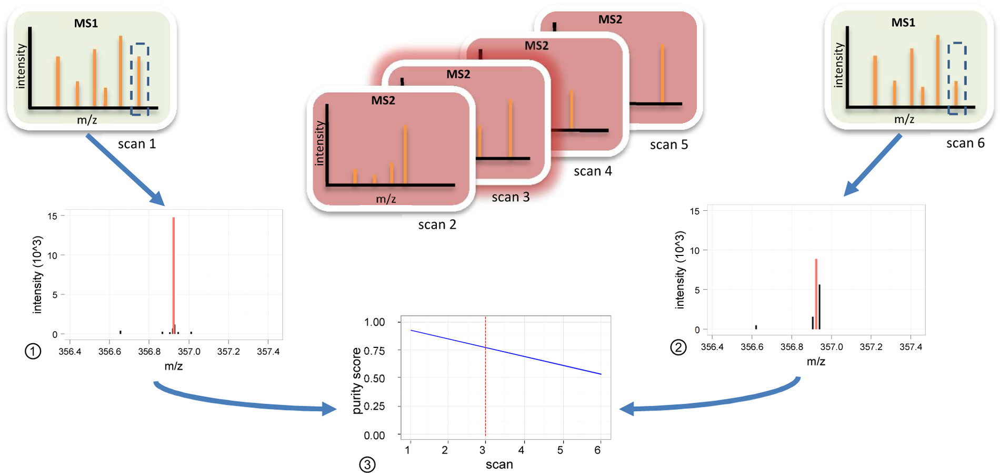
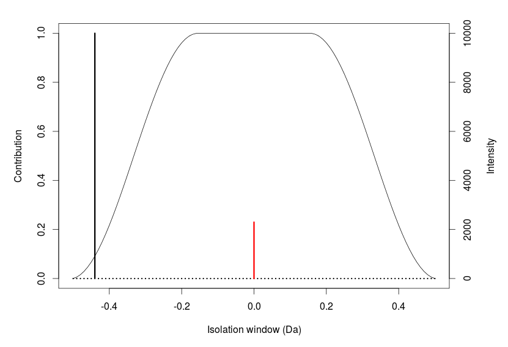
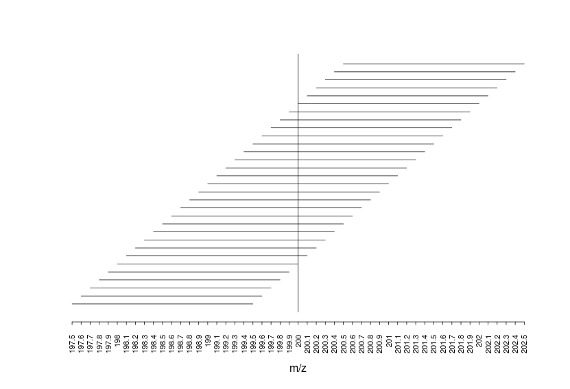
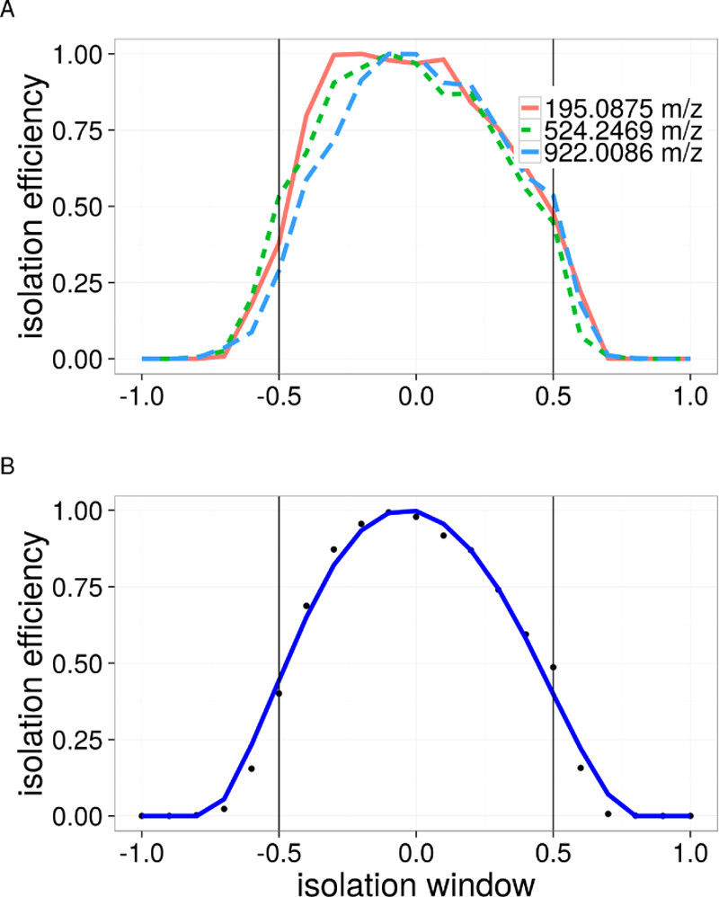
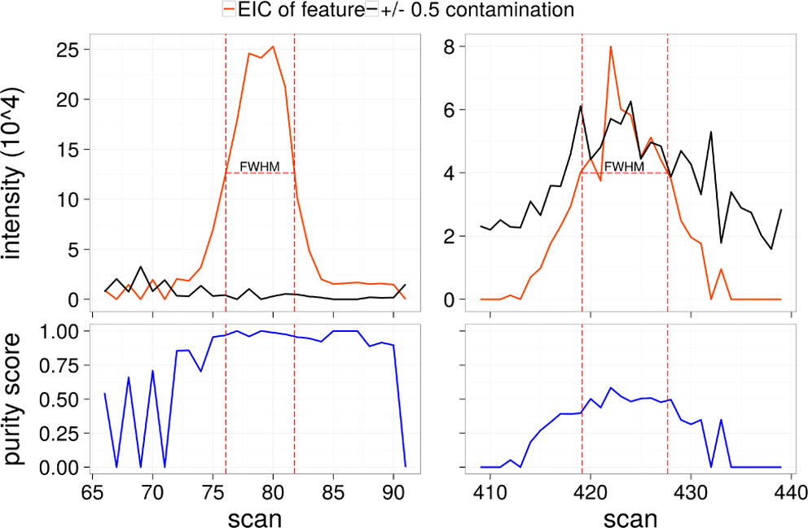

# Introduction

The msPurity R package was originally developed to assess the contribution of the targeted precursor in a fragmentation isolation window using a metric called "precursor ion purity". See associated paper  [@Lawson2017]. 

A number of updates have been made since the original paper and the full functionality of msPurity now includes the following:

* Assess the contribution of the targeted precursor of acquired fragmentation spectra by checking isolation windows using a metric called "precursor ion purity" (Works for both LC-MS(/MS) and DIMS(/MS) data)
* Assess the anticipated precursor ion purity of XCMS LC-MS features where no fragmentation has been acquired
* Map fragmentation spectra to XCMS LC-MS features
* Filter and average MS/MS spectra from an LC-MS/MS dataset
* Create a spectral-database of LC-MS(/MS) data and associated annotations
* Perform spectral matching of query MS/MS spectra against library MS/MS spectra
* Export fragmentation spectra to MSP format


What we call "Precursor ion purity" is a measure of the contribution of a selected precursor peak in an isolation window used for fragmentation. The simple calculation involves dividing the intensity of the selected precursor peak by the total intensity of the isolation window. When assessing MS/MS spectra this calculation is done before and after the MS/MS scan of interest and the purity is interpolated at the time of the MS/MS acquisition. The calculation is  similar to the "Precursor Ion Fraction" (PIF) metric described by [@Michalski2011] for proteomics with the exception that purity here is interpolated at the recorded point of MS/MS acquisition using bordering full-scan spectra. Low-abundance ions can be excluded, and an instrument-specific isolation efficiency curve can weight the contributing ions.

The supported workflows use two main classes

*  **purityA**
    + Assessing precursor purity of previously acquired MS/MS spectra: A user has acquired either LC-MS/MS or DIMS/MS spectra and an assessment is made of the precursor purity for each MS/MS scan
    + Further processing of the purityA object include - fragmentation spectra filtering, averaging, MSP creation, spectral-database creation and spectral matching
* **purityX**
    + Assessing precursor purity of anticipated isolation windows for LC-MS/MS spectra. i.e. a user has acquired from an LC-MS full scan (MS1) data and an assessment is to be made of the precursor purity of detected features using anticipated or theoretical isolation windows. This information can then be used to guide further targeted MS/MS experiments.
  
The DIMS workflow, including `purityD()` and `dimsPredictPuritySingle()`, is deprecated and will receive no further bug fixes or feature development. There is no direct replacement in msPurity. Existing calls remain functional during deprecation; see `help("msPurity-deprecated", package = "msPurity")`.

# purityA

## Assessing precursor purity of previously acquired MS/MS spectra

Start with the four runs in `msPurityData`. Two contain acquired MS/MS scans
(`LCMSMS_`) and two contain MS1 scans only (`LCMS_`). Convert them into one
Parquet study. Both workflows below reuse these spectra.

```{r packages, message=FALSE, warning=FALSE}
library(msPurity)
library(xcms)
```

```{r study, message=FALSE}
mzml_dir <- system.file("extdata", "lcms", "mzML", package = "msPurityData",
                        mustWork = TRUE)
files <- list.files(mzml_dir, pattern = "[.]mzML$", full.names = TRUE)
work <- tempfile("mspurity-")
dir.create(work)
study <- file.path(work, "study")
MsBackendParquet::mzMLToParquet(files, path = study, engine = "mzr",
                                verbose = FALSE)
raw <- Spectra::Spectra(Spectra::backendInitialize(
    MsBackendParquet::MsBackendParquet(), path = study))
is_dda <- startsWith(basename(Spectra::dataOrigin(raw)), "LCMSMS_")
dda <- raw[is_dda]
```

For each fragmentation event, `purityA()` assesses the isolation window in
the preceding and following MS1 scans and interpolates to the acquisition time.
Select MS2 events in the feature detection region (30–90 seconds, precursor
*m/z* 100–200). Retain every MS1 scan and its full mass range so each event
has its original neighbours and potential contaminating ions.



```{r acquired-purity, message=FALSE}
rt <- Spectra::rtime(dda)
precursor <- Spectra::precursorMz(dda)
selected_ms2 <- rt >= 30 & rt <= 90 & precursor >= 100 & precursor <= 200
scans <- dda[which(Spectra::msLevel(dda) == 1L | selected_ms2)]
pa <- purityA(scans, cores = 1L)
purity <- purityTable(pa)
head(purity[c("filename", "seqNum", "precursorMZ", "precursorRT", "inPurity")])
```

`aPurity` measures the peak closest to the recorded precursor mass in the
nearest MS1 scan. `iPurity` measures the most intense peak in that window.
`inPurity` is the interpolated score and `inpkNm` is the interpolated number
of peaks in the window. Some example scans have a recorded precursor outside
its isolation bounds. Their interpolated purity is missing.

## Isolation efficiency

An ion's position in the isolation window affects how much of its intensity
reaches the fragmentation spectrum. In the example below the target (red)
has weight 1, while a contaminant (black) has weight 0.1. Its contribution
falls from 10,000 to 1,000 after weighting.



Sliding a window across a single precursor of known mass measures how the
instrument transmits ions at different positions in the window.



The measured response for a Thermo Fisher Q Exactive with a 0.5 Da window
is available as `iwNormQE.5()` [@Lawson2017]. Other options include a Gaussian
curve (`iwNormGauss()`), a raised cosine (`iwNormRcosine()`), or a custom
function returning a weight between zero and one for each offset.



To see how weighting affects the same scans, apply a Gaussian curve to one
of the two DDA runs.

```{r isolation-efficiency, message=FALSE}
origin <- Spectra::dataOrigin(scans)
weighted <- purityA(scans[origin == origin[1]], cores = 1L, iwNorm = TRUE,
                    iwNormFun = iwNormGauss(sdlim = 3, minOff = -0.5, maxOff = 0.5))
head(purityTable(weighted)[c("seqNum", "precursorMZ", "inPurity")])
```

## Map fragmentation scans to xcms features

In xcms 4, each sample links to its MS1 spectra through the run recorded in
`dataOrigin`. The helper below detects chromatographic peaks with centWave and
groups peaks across the two runs. We use the same procedure later for the
MS1-only samples. Restrict feature detection to 30–90 seconds for this example.

```{r detect-features, message=FALSE}
detect_features <- function(ms1, noise = 100) {
    origins <- unique(Spectra::dataOrigin(ms1))
    samples <- S4Vectors::DataFrame(sample_name = basename(origins), origin = origins)
    experiment <- MsExperiment::MsExperiment(sampleData = samples, spectra = ms1)
    experiment <- MsExperiment::linkSampleData(
        experiment, with = "sampleData.origin = spectra.dataOrigin")

    peaks <- findChromPeaks(experiment, param = CentWaveParam(
        snthresh = 3, noise = noise, ppm = 10, peakwidth = c(3, 30)),
        BPPARAM = BiocParallel::SerialParam())
    mz <- chromPeaks(peaks)[, "mz"]
    peaks <- filterChromPeaks(peaks, keep = mz >= 100 & mz <= 200)
    groupChromPeaks(peaks, param = PeakDensityParam(
        sampleGroups = rep("sample", nrow(samples)), minFraction = 0,
        bw = 5, binSize = 0.017))
}
ms1_window <- function(sp) {
    Spectra::filterRt(Spectra::filterMsLevel(sp, 1L), c(30, 90))
}
features <- detect_features(Spectra::filterMzRange(ms1_window(dda), c(100, 200)))
pa <- frag4feature(pa, xcmsObj = features)
linked <- groupedSpectra(pa, legacy = FALSE)
head(Spectra::spectraData(linked, c("precursorMz", "rtime")))
```

`frag4feature()` links a fragmentation scan to a chromatographic peak by its
precursor mass, retention time and sample. A scan outside the detected peaks
can still have a precursor purity measurement.

## Filter, average and export fragmentation spectra

`filterFragSpectra()` flags peaks using signal-to-noise ratio, relative
abundance, intensity and precursor purity. Here we pool scans linked to each
feature across both runs and export the averages for exchange with MSP tools.

```{r average-and-export, message=FALSE}
pa <- filterFragSpectra(pa)
pa <- averageAllFragSpectra(pa)
length(averagedSpectra(pa, legacy = FALSE))
createMSP(pa, method = "all", msp_file_pth = file.path(work, "features.msp"))
```

To give each run its own average before combining runs, use the following
sequence on the filtered object instead.

```{r per-run-averages, eval=FALSE}
pa <- averageIntraFragSpectra(pa)
pa <- averageInterFragSpectra(pa)
```

## Reopen and match the processed spectra

The results dataset stores feature associations, consensus spectra and links
back to the raw study. Reopen the MS2 averages with `readProcessedSpectra()`
and search them against the small MoNA library bundled with msPurity.

```{r parquet-results, message=FALSE}
results <- createDatabase(pa, features, format = "parquet", study = study,
                          outDir = work, dbName = "results")
consensus <- readProcessedSpectra(results, msLevel = 2L, method = "all")
length(consensus)
msp <- system.file("extdata", "tests", "library", "mini_mona.msp",
                   package = "msPurity", mustWork = TRUE)
reference <- convertLibraryToParquet(msp, file.path(work, "library"),
                                     format = "msp", dialect = "mona")
search <- spectralMatching(results, reference, format = "parquet",
                           q_spectraTypes = "av_all")
head(search$matchedResults[c("qpid", "library_accession", "dpc", "rank")])
```

The LC-MS/MS processing and spectral matching vignette compares this score
with BLINK [@Harwood2023] and shows how to recover the match evidence from disk.

# purityX

## Predict precursor purity from an MS1-only run

`purityX()` estimates how much of a hypothetical isolation window a feature
would occupy. Use the MS1-only runs from the same study and choose offsets
that reflect the planned fragmentation experiment. Here a higher centWave
noise threshold selects strong chromatographic peaks and speeds up feature
detection. The purity calculation uses the original MS1 intensities across
the full isolation window. Select the two features with the largest mean peak
area observed in both runs.



```{r predicted-purity, message=FALSE}
ms1_features <- detect_features(ms1_window(raw[!is_dda]), noise = 5e5)
area <- rowMeans(featureValues(ms1_features, value = "into"))
selected <- head(order(area, decreasing = TRUE, na.last = NA), 2)
px <- purityX(ms1_features, xgroups = selected, purityType = "purityFWmedian",
              offsets = c(0.5, 0.5), ilim = 0, cores = 1L)
px@predictions
```

Each row summarises one feature across its chromatographic peaks. Here each
peak contributes its median purity over its full retention-time width. The mean
and median describe predicted precursor purity, and `pknm` gives the median
number of peaks in the isolation window. Features with high predicted purity
are candidates for targeted MS/MS acquisition.

# References
